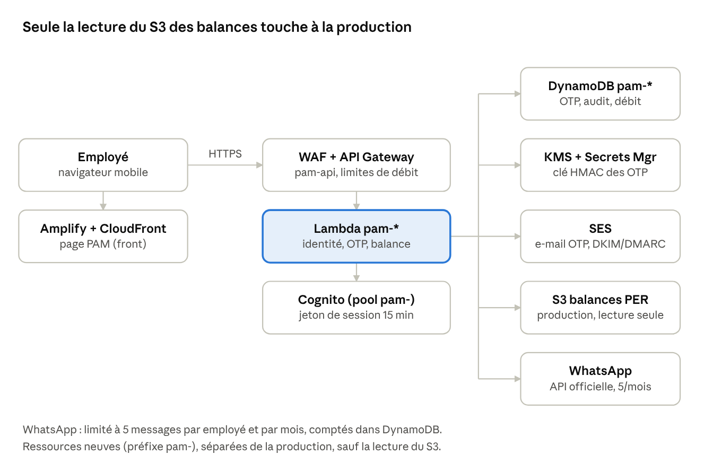

# PAM — Cahier des charges et architecture

28 octobre 2026 · Grégory HILAIRE · dossier remis au développeur de la version complète

## Comment lire ce dossier

Deux textes se complètent. Celui-ci dit ce que PAM doit devenir. `modele_authentification.md`, et le Word du même nom, décrit la machine d'authentification déjà en service : il faut la reprendre, pas la réécrire. Le courriel du code est `pam_otp_email.html`. Le dessin `pam-architecture.png` est la cible, pas le déploiement actuel.

Pièces à garder ensemble :

- `PAM_cahier_des_charges.md` et `PAM_cahier_des_charges.docx`
- `modele_authentification.md` et `modele_authentification.docx`
- `pam_otp_email.html`
- `pam-architecture.png`
- le programme sous `pam/plateforme/`
- l'alimentation des balances sous `Export rapports S3/` et `pam/export_shivam.py`

## Version déjà en service

Le site en service est https://wskln14tzj.execute-api.us-east-1.amazonaws.com/ . Compte `790561526299`, région `us-east-1`. Une fonction Lambda, `pam-api`, handler `serveur.gestionnaire_lambda`, rôle `pam-api-lambda`, sert à la fois les pages et l'API. Le cookie reste donc sur la même origine.

La publication se fait avec `python -u pam/plateforme/deploy/publier.py`. Le fichier `pam/plateforme/infra/stack.py` est une esquisse CDK : ce n'est pas le chemin qui met le site à jour.

| Pièce | Nom en service |
| --- | --- |
| Table | `pam-etat`, clé `pk`, lecture cohérente |
| Secret HMAC | `pam/otp-hmac`, dans le coffre. Il ne se copie ni dans le code, ni dans git, ni dans ce dossier. |
| Balances | seau `acme-pam-balances`, préfixe `pam/balances`, chiffrement AES256, privé |
| Profils | `s3://acme-prospection-data/vault/vault-employee-list.csv` |
| Expéditeur | `autorapport@acmehaiti.com`, réponse `dit@acmehaiti.com` |
| Session | cookie `pam_session`, pas un pool Cognito |

Les colonnes lues du profil sont `employee_code`, `active`, `date_of_birth` au format `MM/JJ/AAAA`, `email_address`, `telephone_number` et `first_name`. La date demandée à l'écran est huit chiffres `JJMMAAAA`, dans un champ masqué comme un mot de passe, avec Afficher et Masquer. Le 27 octobre 1990 s'écrit `27101990`.

SES est sorti du bac à sable. Les deux identités, le domaine `acmehaiti.com` et l'adresse d'expédition, sont vérifiées. Le rôle doit pouvoir envoyer depuis les deux. Le domaine seul ne suffit pas : SES contrôle l'identité de l'adresse.

Le nom `pam.acmehaiti.com` n'est pas dans le DNS. Un alias posé seul devant l'adresse de la passerelle casse le certificat et le contrôle d'hôte. Un domaine propre demande un certificat et un domaine personnalisé sur la passerelle.

### Fichiers à ouvrir en premier

- `pam/plateforme/noyau.py` : les règles. C'est le contrat métier.
- `pam/plateforme/depot.py` : la table, les clés, les durées.
- `pam/plateforme/serveur.py` : HTTP, le cookie, SES, la lecture S3.
- `pam/plateforme/statique/` : les quatre écrans, `index.html`, `pam.css`, `pam.js`.
- `pam/plateforme/test_noyau.py` : 15 parcours sans réseau. Les lancer avec `python -m unittest test_noyau.py` depuis `pam/plateforme`.
- `pam/pam_otp_email.html` : le modèle du code.
- `pam/export_shivam.py` : le découpage des rapports Shivam en un objet par employé.

### Ce que l'employé peut déjà faire

1. Saisir son code et sa date. Un échec répond toujours « Informations incorrectes ».
2. Recevoir le code sur le courriel masqué du profil. WhatsApp est affiché et désactivé, libellé « Indisponible ».
3. Saisir les six chiffres. Le compte à rebours est de 5 minutes. Renvoyer attend 60 secondes, au plus 3 fois en 15 minutes.
4. Voir sa dernière balance PER, ou le texte « Aucune balance n'est disponible pour le moment. » Fermer la session, ou la voir se fermer après 5 minutes sans action.

Les règles fines, les verrous, le captcha, le gel de 72 heures et les clés Dynamo sont dans `modele_authentification.md`. Elles sont le modèle à garder.

### Forme des objets

Une balance est un objet par employé : `pam/balances/per/{CODE}.json`.

```json
{
  "schema": 1,
  "code_employe": "ZORA0001",
  "nom": "Zora Dupont",
  "snapshots": [
    {
      "periode": "2026-10",
      "date_rapport": "2026-10-27",
      "balance": "10.50",
      "nom": "Zora Dupont"
    }
  ]
}
```

L'écran prend la photo la plus récente et affiche le montant en français, par exemple `10,50`, avec la date du rapport. La clé est calculée depuis le code de la session. Un paramètre qui demande le dossier d'une autre personne répond « Accès refusé. »

S'il n'y a pas d'objet, la réponse est « Aucune balance n'est disponible pour le moment. » Elle ne doit pas devenir « Service momentanément indisponible. » Le rôle a `s3:GetObject` sur `pam/balances/per/*` et `s3:ListBucket` limité au préfixe `pam/balances/*`. Sans le droit de lister, une clé absente revient en refus, et l'écran parle d'une panne.

Les bulletins sont déjà déposés à `pam/balances/payslip/{CODE}.json`, schéma 1, liste `bulletins`. L'écran ne les montre pas encore.

L'alimentation est `Export rapports S3/ExportRapportsS3.exe`. Il prend les deux rapports Shivam du mois, `Employee_PER_Accounts` et `Emp_Salary__Pay_HeadDetails`. La destination est dans `regles_export_rapports_s3.yaml`, à côté du programme. `--simulation` écrit le seau et n'envoie aucun courriel. Sans ce paramètre, le courriel de mise à jour part vers les destinataires actifs du YAML, et seulement après une écriture réussie. Un changement de seau se fait dans le YAML : il n'y a pas à recompiler l'exécutable.

### Courriel du code

Le sujet est « ACME SA — Code de vérification PAM ». Le HTML est `pam_otp_email.html`. Les emplacements sont `{{CODE}}`, `{{VALIDITE}}`, `{{PRENOM}}` et `{{ANNEE}}`. Le prénom vient de `first_name`. Un prénom entièrement en capitales est remis en casse de titre. S'il manque, la salutation est « Bonjour, ». Il est échappé. Une partie texte porte le même code. Les avis de verrou, de changement de contact et de consultation restent en texte, sujet « ACME SA — PAM ». Le courriel ne contient ni la balance, ni le code employé, ni l'adresse complète.

### À ne pas refaire

- Remplacer le cookie par Cognito. La session en service est le contrat.
- Séparer les pages et l'API sur deux origines. Le cookie `SameSite=Strict` ne suivrait plus.
- Inventer un nom de modèle WhatsApp ou un jeton. Le bouton reste gris tant que ces deux pièces réelles ne sont pas fournies.
- Écrire dans le profil RH, ou journaliser un code, une date, un OTP ou une adresse.
- Traiter `infra/stack.py` comme le déploiement.
- Déposer le domaine par un simple alias DNS.

## Ce qui reste pour la version complète

L'authentification, le courriel HTML du code, la lecture de sa seule balance et le dépôt mensuel des rapports sont en service. La version complète ajoute ceci, autour de la machine existante.

- WhatsApp sur le numéro du profil, avec le quota de 5 messages par employé et par mois civil, renvois compris. À la limite, WhatsApp est refusé et le courriel reste proposé s'il existe. Les avis ne partent jamais par WhatsApp.
- L'écran du bulletin déjà stocké, en lecture seule, pour la personne de la session seulement.
- AWS WAF devant l'API.
- Le domaine `pam.acmehaiti.com`, avec certificat et domaine personnalisé.
- Le créole en option, si la DRH le confirme encore.
- L'exploitation : rotation du secret HMAC, alertes sur les pics d'échecs, les rebonds et les envois WhatsApp inhabituels, et un interrupteur qui coupe PAM sans toucher aux autres applications.

## Vision et périmètre

PAM (Plateforme ACME Multifonction) permet à chaque employé d'ACME S.A. de consulter sa propre balance PER, de façon personnelle et protégée par un code à usage unique (OTP) reçu par e-mail ou par WhatsApp.

- **Utilisateurs** : les employés d'ACME disposant d'un code employé et d'une adresse e-mail ou d'un numéro WhatsApp dans le profil RH (tous n'ont pas d'e-mail professionnel).
- **Lecture seule** : PAM n'écrit jamais dans les données RH et n'affiche que la balance PER de la personne authentifiée.
- **Hors périmètre** : modification des coordonnées (réservée à la DRH), demandes de congé, consultation par un tiers.
- **Nom** : PAM, Plateforme ACME Multifonction, avec le clin d'œil créole « pa m » (« ce qui est à moi ») qui signale à l'employé que l'outil est personnel. Autres idées étudiées : Plateforme ACME Mienne, Plateforme ACME Mon espace. Nom validé.

## Décisions retenues

Le code employé et la date de naissance ne suffisent jamais : seul l'OTP reçu par e-mail ou par WhatsApp donne accès à la balance.

| Sujet | Décision |
| --- | --- |
| Canal OTP | E-mail du profil RH ; WhatsApp sur le numéro du profil pour les employés sans e-mail professionnel ou qui le préfèrent |
| Quota WhatsApp | 5 messages WhatsApp par mois et par employé, renvois compris |
| Coordonnées | Non modifiables par l'employé : demande à la DRH, qui authentifie le demandeur puis fait le changement |
| Blocage après changement | 72 heures, validé par la DRH |
| Facteur 1 | Code employé + date de naissance : secret faible, traité comme simple identifiant |
| Facteur 2 | OTP à 6 chiffres, clé de l'accès |
| Source des balances | Rapport importé dans un bucket S3 de la zone de production ; PAM y accède en lecture seule |
| E-mail | Mêmes procédés que pour SISA |
| Compte WhatsApp | Compte WhatsApp Business d'ACME déjà existant ; responsable : Grégory Hilaire |
| Isolation | Ressources AWS dédiées, préfixe `pam-`, séparées de la production, sauf la lecture du S3 des balances |

## Parcours utilisateur

L'employé passe par quatre écrans, en français (créole en option), pensés pour téléphone.

1. **Identification** : saisie du code employé et de la date de naissance en huit chiffres `JJMMAAAA`, dans un champ masqué. En cas d'échec, un seul message générique (« Informations incorrectes »), identique que le code existe ou non, avec un délai de réponse uniforme.
2. **Canal de réception** : l'employé choisit entre l'e-mail du profil (première lettre, `***`, puis le domaine) et WhatsApp sur le numéro du profil (+509 •• •• ••42), tous deux affichés masqués. Un canal absent du profil est grisé. Pour WhatsApp, l'écran indique le nombre de messages restants ce mois-ci (sur 5). Tant que le modèle Meta et le jeton ne sont pas fournis, le bouton reste « WhatsApp — Indisponible » et n'envoie rien. L'employé ne peut jamais saisir une autre adresse ou un autre numéro.
3. **Saisie de l'OTP** : 6 chiffres, compte à rebours de validité, bouton « Renvoyer » avec délai d'attente (un renvoi par WhatsApp compte dans le quota).
4. **Balance PER** : affichage de la balance de l'employé et de sa date de mise à jour, bouton « Se déconnecter », déconnexion automatique après 5 minutes d'inactivité.

Si le profil n'a ni e-mail valide ni numéro WhatsApp, ou si le contact choisi a été modifié depuis moins de 72 heures, l'écran 2 indique « Contactez la DRH » pour ce contact et aucun code n'est envoyé. Quand le quota de 5 messages WhatsApp du mois est atteint, WhatsApp est grisé et l'e-mail reste proposé s'il existe ; sinon, « Contactez la DRH ».

## Exigences de sécurité

Toutes les exigences ci-dessous sont obligatoires avant la mise en production.

| Domaine | Exigence |
| --- | --- |
| Facteur 1 | Limitation de débit par IP et par code employé ; verrouillage progressif après 5 échecs ; CAPTCHA après 3 échecs ; AWS WAF devant l'API |
| Génération de l'OTP | 6 chiffres, générateur cryptographique (jamais `Math.random`), lié à la session et au canal |
| Validité de l'OTP | 5 minutes, usage unique, invalidé après usage ou après un renvoi |
| Tentatives | 3 essais par OTP ; 3 renvois par fenêtre de 15 minutes ; 60 secondes entre deux envois |
| Quota WhatsApp | 5 messages par employé et par mois civil, renvois compris, comptés côté serveur (table DynamoDB avec clé employé + mois) ; au-delà, WhatsApp est refusé |
| Stockage de l'OTP | Hachage HMAC avec clé dans Secrets Manager (chiffrement KMS), expiration automatique (TTL DynamoDB) ; jamais en clair |
| Session | Durée de 15 minutes maximum ; cookie HttpOnly, Secure, SameSite=Strict ; rien dans l'URL ni dans localStorage |
| Autorisation | L'identité vient du jeton, jamais d'un paramètre : un employé ne lit que sa propre balance |
| Coordonnées | Lues uniquement dans le profil RH ; non modifiables par l'employé ; blocage de 72 heures après un changement fait par la DRH, pour l'e-mail comme pour le numéro |
| Accès aux balances | Lecture seule du bucket S3 de production, limitée au préfixe des balances, par un rôle dédié ; aucun autre droit sur la production |
| Notification | Message à l'employé après chaque connexion réussie et chaque verrouillage (par e-mail s'il existe ; jamais par WhatsApp, pour préserver le quota) |
| Transport | HTTPS partout, HSTS, en-têtes CSP, X-Frame-Options, X-Content-Type-Options |
| Journaux | Aucune donnée personnelle (code employé, date de naissance, OTP, e-mail et numéro masqués) ; journal d'audit en ajout seul : qui, quand, canal, résultat, IP ; alertes sur pics d'échecs |
| Données | La balance est lue à la demande depuis S3 ; PAM n'en garde aucune copie durable |

Le code employé et la date de naissance restent devinables : toute la protection repose sur l'OTP et sur les limites de tentatives.

## Architecture AWS

La cible réutilise les services AWS déjà en place chez ACME (CloudFront, API Gateway, Lambda, DynamoDB, SES, et WAF devant l'API), dans des ressources préfixées `pam-`, en lecture seule sur le seau des balances. Le dessin ci-dessous est cette cible. La version en service est plus petite : une fonction, une passerelle HTTP, le cookie décrit dans le modèle d'authentification. On ajoute WAF et le domaine devant cette fonction. On ne remplace pas le cookie par Cognito.



L'employé charge la page, puis appelle l'API. La fonction vérifie l'identité, envoie et contrôle le code, et lit la balance dans le seau. La session est le cookie `pam_session`.

- **Rôles IAM** : le rôle `pam-api-lambda` lit et écrit `pam-etat`, lit le secret `pam/otp-hmac`, envoie depuis les deux identités SES, et lit le seau des balances. Aucun droit `*`. Le jeton WhatsApp s'ajoute seulement quand le canal est branché.
- **Accès au S3** : `s3:GetObject` sur `pam/balances/per/*` et `s3:ListBucket` limité au préfixe `pam/balances/*`. Le seau est chiffré en AES256 : pas de `kms:Decrypt`. Aucun droit d'écriture.
- **Quota WhatsApp** : quand le canal existera, le compteur durable (employé et mois) vit dans `pam-etat`, pas dans la mémoire de la fonction. Il est vérifié et incrémenté avant chaque envoi.
- **Journaux** : CloudWatch Logs sans donnée personnelle, journal d'audit en ajout seul dans DynamoDB (même principe de refus d'écriture que les tables `conges-dispo-` d'historique).
- **Région** : us-east-1, compte `790561526299`. Le seau des balances est `acme-pam-balances`, préfixe `pam/balances`, chiffrement AES256. Il n'y a pas de clé KMS à déchiffrer sur ce seau.

## Canal e-mail

L'OTP part par Amazon SES en reprenant les mêmes procédés que pour SISA : même façon de configurer le domaine d'envoi, l'authentification et le suivi des rebonds. Les points ci-dessous servent de liste de vérification pour PAM.

1. **Adresse d'envoi** : `autorapport@acmehaiti.com`, réponse `dit@acmehaiti.com`. Les deux identités sont vérifiées. Le rôle a `ses:SendEmail` sur le domaine et sur l'adresse.
2. **Authentification du domaine** : DKIM, SPF et DMARC du domaine `acmehaiti.com`, déjà utilisés pour l'envoi en service.
3. **Mode production SES** : le compte est sorti du bac à sable. Un destinataire extérieur n'est plus refusé pour cette raison.
4. **Rebonds et plaintes** : à brancher pour la version complète. En cas d'adresse invalide, l'employé est invité à choisir WhatsApp quand ce canal existe, et la DRH est alertée.
5. **Message** : le fichier `pam_otp_email.html`. Sujet « ACME SA — Code de vérification PAM ». Emplacements `{{CODE}}`, `{{VALIDITE}}`, `{{PRENOM}}`, `{{ANNEE}}`. Le code vaut 5 minutes, une seule fois, et le bandeau dit de ne le communiquer à personne, y compris à un collègue ou à la DIT. Aucun lien cliquable. Une partie texte accompagne le HTML.
6. **Exposition** : le courriel contient le prénom et le code. Il ne contient ni la balance, ni le code employé, ni l'adresse complète.

## Canal WhatsApp : mise en service du compte existant

Le compte WhatsApp Business d'ACME existe déjà et son responsable est Grégory Hilaire. Avant le premier envoi d'OTP, vérifier les points suivants. Meta exige un portefeuille Meta Business actif, un compte WhatsApp Business et un numéro dédié ([Wati, prérequis](https://www.wati.io/blog/whatsapp-api-prerequisites) ; [documentation Meta](https://developers.facebook.com/documentation/business-messaging/whatsapp/embedded-signup/overview/)).

- [ ] **Propriété et accès** : le portefeuille Meta Business est au nom légal d'ACME S.A., avec au moins deux administrateurs ayant l'authentification à deux facteurs.
- [ ] **Vérification de l'entreprise** : terminée. Les messages d'authentification exigent une voie approuvée, dont la vérification Meta ([Wati](https://www.wati.io/blog/whatsapp-api-prerequisites)).
- [ ] **Numéro** : dédié à l'API, appartenant à ACME, jamais le numéro personnel d'un employé.
- [ ] **Modèle de message « Authentification »** : approuvé par Meta, en français, avec le bouton « Copier le code ».
- [ ] **Facturation** : moyen de paiement d'ACME actif dans WhatsApp Manager ; le coût maximal est de 5 messages par employé et par mois.
- [ ] **Palier de messages Meta** : suffisant pour le nombre d'employés susceptibles de se connecter le même jour.
- [ ] **Jeton** : utilisateur système avec jeton long dans AWS Secrets Manager, jamais un jeton lié à un compte personnel ; rotation planifiée.
- [ ] **Consentement** : chaque employé accepte d'être contacté par WhatsApp ; le consentement est enregistré et peut être retiré.
- [ ] **Quota** : la limite de 5 messages par mois est appliquée par PAM (compteur DynamoDB), indépendamment des limites de Meta.
- [ ] **Pilote** : test avec quelques employés volontaires avant l'ouverture à tous.

**Précautions** : ne partagez jamais le code de vérification du numéro, méfiez-vous des faux « supports Meta » qui demandent un accès, et si un prestataire intervient, le portefeuille et le WABA restent la propriété d'ACME, avec ACME comme administrateur principal.

## Changement de coordonnées par la DRH

PAM ne contient aucune fonction de modification : l'adresse e-mail (et le numéro WhatsApp) est lue dans le profil RH, que seule la DRH peut changer. C'est la procédure autour de ce changement qui protège l'accès, car quiconque contrôle l'e-mail ou le numéro reçoit les OTP.

1. L'employé dépose sa demande auprès de la DRH.
2. La DRH authentifie le demandeur par un moyen indépendant de PAM : présentation d'une pièce d'identité à l'accueil, ou rappel téléphonique sur le numéro déjà connu, ou confirmation par le responsable hiérarchique.
3. La DRH enregistre le changement avec deux personnes (l'une saisit, l'autre valide) et le consigne dans le journal RH.
4. PAM bloque l'usage de la nouvelle adresse ou du nouveau numéro pendant 72 heures (délai validé par la DRH) et envoie une alerte à l'ancien contact et à l'employé.
5. Pendant ce délai, l'écran 2 affiche « Contactez la DRH » au lieu d'envoyer un code.

Les demandes reçues par e-mail ou par message sans vérification d'identité sont refusées : c'est le scénario d'attaque le plus probable.

## Tests, livraison et exploitation

PAM ne passe en production que si tous les cas ci-dessous échouent ou réussissent comme prévu.

| Cas testé | Résultat attendu |
| --- | --- |
| Parcours normal avec OTP correct, par e-mail | Balance affichée |
| Parcours normal par WhatsApp | Balance affichée, quota du mois décrémenté de 1 |
| 6e message WhatsApp dans le même mois (renvois compris) | WhatsApp refusé, e-mail proposé s'il existe, sinon « Contactez la DRH » |
| Nouveau mois | Quota remis à 5 |
| Mauvais OTP, puis 3 échecs | Refus, OTP invalidé, nouvel envoi nécessaire |
| OTP expiré (plus de 5 minutes) ou réutilisé | Refus |
| Code employé inexistant ou date de naissance fausse | Même message générique et même délai que pour un code valide |
| 3 échecs d'identification | Captcha arithmétique, question gardée sur le serveur |
| 5 échecs, puis 10, puis 15 | Verrou d'une minute, puis 15 minutes, puis une heure. Le compteur n'augmente plus pendant le verrou |
| Lecture de la balance d'un autre employé | Refus côté serveur |
| Employé absent du rapport S3 | Message clair, aucune donnée d'un autre employé |
| Le rôle PAM tente d'écrire ou de lire hors du préfixe des balances | Refus (AccessDenied) |
| E-mail ou numéro modifié depuis moins de 72 heures, ou absent | Aucun envoi, message « Contactez la DRH » |
| Aucune donnée personnelle dans les journaux | Vérifié par relecture des journaux de test |
| Affichage sur petit écran et connexion lente | Parcours utilisable |

**Livraison** : la version en service se publie avec `pam/plateforme/deploy/publier.py`. La version complète peut décrire l'ajout de WAF et du domaine en code. L'esquisse `infra/stack.py` ne remplace pas le script de publication tant qu'elle n'a pas été adoptée. Les 15 tests de `test_noyau.py` passent avant chaque publication. La fumée de publication exige que la page contienne « Vous identifier », « Indisponible », « JJMMAAAA » et un champ de date de type mot de passe.

**Exploitation** : rotation planifiée de la clé HMAC, alertes sur les pics d'échecs, sur les rebonds d'e-mail et sur les envois WhatsApp inhabituels, et un interrupteur d'urgence qui désactive PAM sans toucher aux autres applications.

## Prompt de développement

Texte à copier tel quel dans l'assistant de code pour continuer la version complète.

```text
RÔLE
Tu es un architecte logiciel et ingénieur sécurité senior. Tu continues « PAM » (Plateforme ACME Multifonctions, clin d'œil créole « pa m » : ce qui est à moi). Une version est déjà en service. Tu l'étends. Tu ne réécris pas l'authentification.

POINT DE DÉPART, À LIRE AVANT TOUTE MODIFICATION
- pam/PAM_cahier_des_charges.md : la cible et ce qui reste.
- pam/modele_authentification.md : la machine à reprendre telle quelle.
- pam/plateforme/noyau.py, depot.py, serveur.py, statique/, test_noyau.py.
- pam/pam_otp_email.html : le courriel du code, emplacements {{CODE}}, {{VALIDITE}}, {{PRENOM}}, {{ANNEE}}.
- pam/export_shivam.py et Export rapports S3/ : un objet JSON par employé dans acme-pam-balances, préfixe pam/balances.

DÉJÀ EN SERVICE, À CONSERVER
- Site : https://wskln14tzj.execute-api.us-east-1.amazonaws.com/ — compte 790561526299, région us-east-1, fonction pam-api, table pam-etat, secret pam/otp-hmac.
- Pages et API sur la même origine. Cookie pam_session : HttpOnly, Secure, SameSite=Strict, 15 minutes. Rien dans localStorage.
- Date de naissance saisie en JJMMAAAA, champ masqué. Le profil Vault est en MM/JJ/AAAA. Comparaison par HMAC.
- Code à 6 chiffres, 5 minutes, usage unique, 3 essais, 3 renvois par 15 minutes, 60 secondes entre deux envois. L'empreinte n'est écrite qu'après un envoi réussi.
- Courriel HTML du modèle, plus une partie texte. Expéditeur autorapport@acmehaiti.com, réponse dit@acmehaiti.com. SES est hors du bac à sable. Les avis restent en texte.
- Lecture de pam/balances/per/{CODE}.json calculée depuis la session. Absence : « Aucune balance n'est disponible pour le moment. » Le rôle a GetObject et ListBucket sur le préfixe.
- WhatsApp affiché et refusé tant qu'un modèle Meta approuvé et un jeton d'utilisateur système réels ne sont pas fournis. Ne pas en inventer.
- Publication : python -u pam/plateforme/deploy/publier.py. infra/stack.py n'est pas le déploiement.
- Tests : python -m unittest test_noyau.py depuis pam/plateforme. Quinze tests, sans réseau.

DÉCISIONS DÉJÀ PRISES
- Canaux OTP : e-mail du profil RH, ou WhatsApp sur le numéro du profil (tous les employés n'ont pas d'e-mail professionnel). L'employé choisit le canal parmi ceux disponibles.
- Quota WhatsApp : 5 messages par employé et par mois civil, renvois compris, comptés côté serveur. À la limite, WhatsApp est refusé ; l'e-mail reste proposé s'il existe, sinon afficher « Contactez la DRH ». Les notifications de connexion ne partent jamais par WhatsApp.
- E-mail : domaine acmehaiti.com, SPF/DKIM/DMARC, SES hors du bac à sable, modèle pam_otp_email.html. Le suivi des rebonds reste à brancher.
- WhatsApp : le compte WhatsApp Business d'ACME existe déjà. Utiliser l'API officielle (Cloud API) avec un modèle de message « Authentification » approuvé, bouton « Copier le code », et un jeton d'utilisateur système dans Secrets Manager.
- Le code employé et la date de naissance sont un facteur faible : seul l'OTP donne accès à la balance.
- L'employé ne peut jamais modifier ses coordonnées dans PAM. Elles viennent du profil RH, que seule la DRH modifie après avoir authentifié le demandeur. Après un changement, le NOUVEAU contact (e-mail ou numéro) ne peut pas recevoir d'OTP pendant 72 heures (délai validé par la DRH), et l'employé est alerté sur l'ancien contact.
- Aucune fonction de modification des coordonnées dans PAM.
- Source des balances : objets déjà déposés dans acme-pam-balances par ExportRapportsS3.exe. PAM lit, il n'écrit pas.

ARCHITECTURE AWS (région us-east-1, compte 790561526299)
- En service : une fonction pam-api derrière une passerelle HTTP, pages et API ensemble, cookie de session. Garder cette forme.
- À ajouter pour la version complète : AWS WAF devant l'API, domaine pam.acmehaiti.com par certificat et domaine personnalisé, pas par un alias DNS seul.
- Accès au seau acme-pam-balances : s3:GetObject sur pam/balances/per/* et s3:ListBucket limité au préfixe pam/balances/*. Chiffrement AES256, pas de KMS sur ce seau. Aucun droit d'écriture. Un objet par employé existe déjà. Ne jamais renvoyer ni journaliser plus que la ligne de la session.
- Session : le cookie déjà en service. Ne pas le remplacer par un pool Cognito.
- Données PAM : la table pam-etat déjà en service (défis, sessions, verrous, captcha, contacts, audit). Le quota WhatsApp s'y ajoute quand le canal existera. Clé HMAC : secret pam/otp-hmac.
- E-mail : Amazon SES. WhatsApp : API officielle Meta.

PARCOURS
1. Écran 1 : code employé + date de naissance JJMMAAAA, champ masqué, bouton Afficher. Échec : message unique « Informations incorrectes », identique que le code existe ou non, délai de réponse uniforme.
2. Écran 2 : courriel masqué (première lettre, ***, domaine). WhatsApp masqué, grisé « Indisponible » tant que le modèle et le jeton manquent. Quand il sera branché, afficher le reste sur 5. Contact absent ou modifié depuis moins de 72 heures : ne rien envoyer, afficher « Contactez la DRH ».
3. Écran 3 : saisie de l'OTP (6 chiffres), compte à rebours, bouton « Renvoyer » avec délai (un renvoi WhatsApp compte dans le quota).
4. Écran 4 : balance PER et date de mise à jour. Déconnexion automatique après 5 minutes d'inactivité.

SÉCURITÉ (OBLIGATOIRE)
- Facteur 1 : limitation de débit par IP et par code employé, verrouillage progressif après 5 échecs, CAPTCHA après 3 échecs, AWS WAF.
- OTP : 6 chiffres, générateur cryptographique, valide 5 minutes, usage unique, 3 essais, 3 renvois par 15 minutes, 60 secondes entre deux envois, lié à la session et au canal, stocké uniquement sous forme de hachage HMAC, TTL automatique.
- Session : cookie HttpOnly, Secure, SameSite=Strict, rien dans l'URL ni dans localStorage. Ne pas le remplacer.
- Autorisation : l'identité vient du jeton, jamais d'un paramètre. Un employé ne lit que sa propre balance.
- Notification : e-mail à l'employé après chaque connexion réussie et chaque verrouillage, s'il a un e-mail.
- HTTPS, HSTS, CSP, X-Frame-Options, X-Content-Type-Options.
- Journaux sans donnée personnelle (code employé, date de naissance, OTP, e-mail et numéro masqués). Journal d'audit en ajout seul (qui, quand, canal, résultat, IP). Alertes sur pics d'échecs et sur les envois WhatsApp inhabituels.
- Aucune copie durable des balances dans PAM.

QUALITÉ
- Tests : parcours normal par e-mail et par WhatsApp, quota (6e message refusé, remise à 5 au changement de mois), mauvais OTP, OTP expiré ou réutilisé, dépassement de tentatives, énumération de comptes, lecture de la balance d'un autre employé (doit échouer), employé absent du rapport, accès S3 hors préfixe (doit échouer), contact modifié récemment ou absent, affichage mobile et connexion lente.
- Garder les 15 tests verts. Publier avec pam/plateforme/deploy/publier.py. Décrire en code seulement ce que la version complète ajoute (WAF, domaine), sans remplacer le script tant qu'il n'est pas adopté.

LIVRABLES
1. Schéma d'architecture et flux d'authentification.
2. Modèle de menaces (STRIDE) avec mesures.
3. Code de l'application et de l'infrastructure.
4. Plan de tests et critères d'acceptation.
5. Procédure d'exploitation : rotation des clés, incidents, interrupteur d'urgence.

Les faits déjà tranchés sont dans la section « Version déjà en service ». Les seules questions encore ouvertes sont dans « Points ouverts ». Ne les invente pas : le modèle WhatsApp et le jeton restent à fournir. Propose l'écart restant, puis code à partir de pam/plateforme.
```

## Points ouverts

Tranché, et déjà en service :

- [x] **Seau des balances** : compte `790561526299`, région `us-east-1`, seau `acme-pam-balances`, préfixe `pam/balances`, AES256. L'import est mensuel, par `ExportRapportsS3.exe`, un objet par employé.
- [x] **Format** : `pam/balances/per/{CODE}.json` et `pam/balances/payslip/{CODE}.json`, schéma 1. L'écran ne lit que le PER.
- [x] **Lecture** : `s3:GetObject` et `s3:ListBucket` limités au préfixe. Pas de clé KMS sur ce seau. Aucun droit d'écriture.
- [x] **Quota WhatsApp** : 5 messages par employé et par mois civil, renvois compris. À la limite, le courriel reste proposé s'il existe, sinon « Contactez la DRH ». Le compteur n'est pas encore branché, parce que le canal est refusé.
- [x] **SES** : expéditeur `autorapport@acmehaiti.com`, réponse `dit@acmehaiti.com`, compte hors du bac à sable, droit d'envoi sur le domaine et sur l'adresse. Le modèle HTML est `pam_otp_email.html`.

Encore ouvert pour la version complète :

- [ ] **Modèle WhatsApp** : nom exact du modèle « Authentification » approuvé, et jeton d'utilisateur système à déposer dans le coffre. Sans ces deux pièces, le bouton reste gris. Ne pas les inventer.
- [ ] **Palier Meta** : le palier de messages suffit-il pour le jour de paie ?
- [ ] **Rebonds SES** : brancher le suivi, prévenir la DRH si l'adresse est invalide, proposer WhatsApp quand il existera.
- [ ] **Domaine** : certificat et domaine personnalisé pour `pam.acmehaiti.com`. Pas un alias DNS seul.
- [ ] **Bulletin à l'écran** : les objets existent. Faut-il les montrer dans la version complète, et sous quelle forme ?
- [ ] **Créole** : le parcours est en français. Confirmer si une bascule créole reste demandée.
